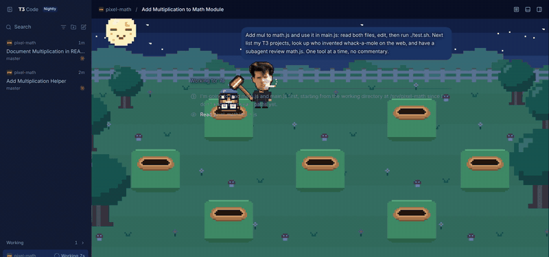
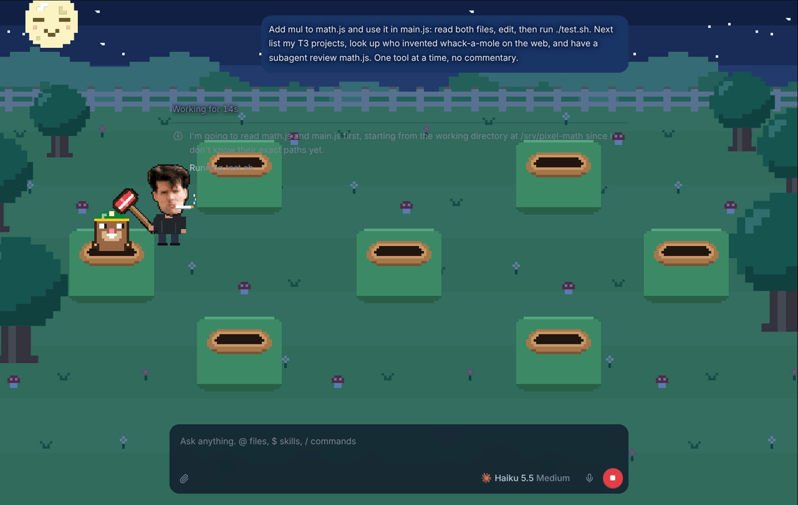
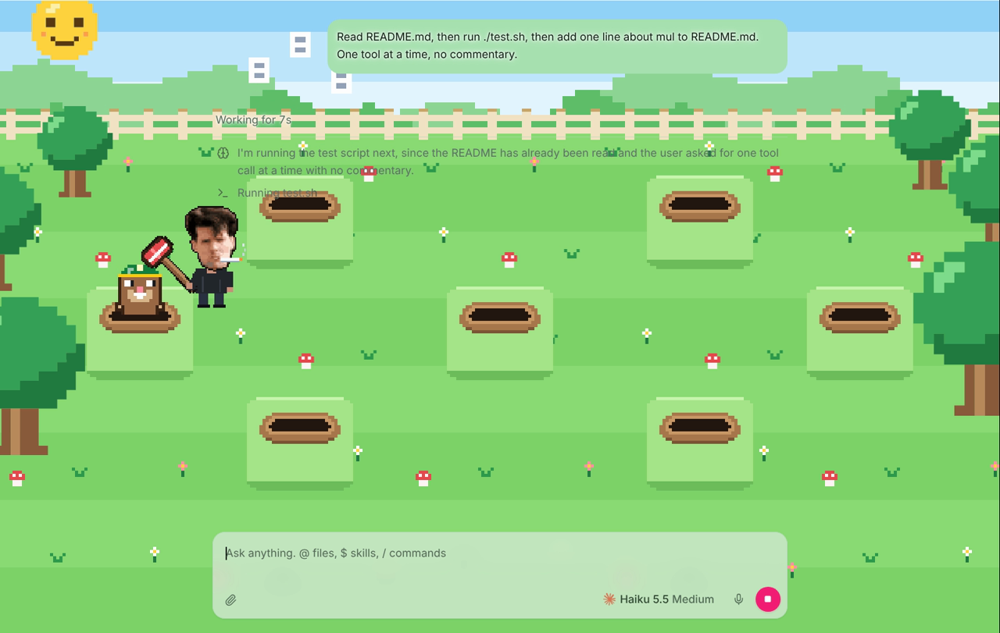

# tool-flow for T3 Code: whack-a-mole in a theme

A theme for [T3 Code](https://t3.codes) that turns the chat's background into a pixel-art meadow where a game of whack-a-mole follows the agent's work: every kind of tool has a hole, a mole comes up when a tool call starts, and the mallet comes down on it when the call ends.



It is one theme file and nothing else. A T3 Code theme is colors plus CSS, so the whole game is CSS: the theme reads which kind of tool the chat's live row shows, and the moles, the mallet and what flies out are all moved by custom properties that transition. The one with the mallet is a pixel portrait.

A longer look, 29 seconds: [`docs/demo.mp4`](docs/demo.mp4).

| Dark mode: the meadow by night | Light mode: the meadow by day |
| :- | :- |
|  |  |

It needs T3 Code 0.1.10 or later, which is on the Nightly track as of November 2026 (**Settings → About → Update track**). The web and desktop apps show it. The mobile app does not use themes.

## Install

On the machine that runs your T3 Code server:

```sh
mkdir -p ~/.t3/userdata/themes
curl -fsSL https://raw.githubusercontent.com/haozhanghz/tool-flow-t3code/main/tool-flow.json -o ~/.t3/userdata/themes/tool-flow.json
t3 theme set tool-flow
```

Connected apps switch to it at once. To undo it, pick another theme in **Settings → Appearance**, or run `t3 theme set t3-chat`.

Without access to the server (for example on app.t3.codes), download [`tool-flow.json`](tool-flow.json) and add it in **Settings → Appearance → Add theme → Choose files**.

On T3 Code 0.1.9 and earlier, a theme has no CSS and a file this large is ignored. [`tool-flow-colors.json`](tool-flow-colors.json) is the palette alone, installed the same way under the name `tool-flow-colors`.

## What it shows

There are no words in the picture. A kind of tool is told by its mole's costume and by what flies out when it is whacked:

| In the chat's live row | The mole | When whacked |
| :- | :- | :- |
| Reading a file, searching | round glasses, holding a book | sheets of paper |
| Editing a file | a pencil behind the ear, holding a pad | pencil shavings |
| Running a command | a hard hat with a lamp | lightning |
| Web search, web fetch | an aerial | ripples |
| A running subagent | a robot's visor | stars |
| MCP and T3 Code's own tools | the prongs of a plug | sparks |
| Everything else | a propeller cap | dust, a nut and a bolt |

## Limits

- It shows what T3 Code's live row shows: one tool at a time, the latest. Calls that run in parallel share a mole, and a call too quick to be drawn is not seen.
- A failed call is whacked like any other.
- Text in the chat lies over the meadow. A halo around the letters keeps them readable.
- A new thread's page shows the meadow without the holes.
- The theme relies on names in T3 Code's page (`data-timeline-row-kind`, the `lucide` icon classes). If a release renames them, the moles stay down and the colors and the meadow remain.
- Checked in T3 Code 0.1.10-nightly.20261115 in Chromium, in windows from 820 by 640 to 1920 by 1080.

## Build

```sh
node build.mjs
```

It needs Node and no packages. It writes both theme files and fails if the CSS passes T3 Code's 50,000 characters. `art/head.mjs <photo>` remakes the portrait's pixels in `art/head.json` (needs ffmpeg). The box and the outline at the top of that file are those of the photo it was made from, so another photo needs its own.

## Notes

- A theme cannot run script or load files. This one reads the icon in the chat's live row and nothing else, and makes no network requests.
- The same game exists as a mod for the Claude desktop app: [tool-flow](https://github.com/haozhanghz/tool-flow).
- T3 Code belongs to its makers. This is a fan-made theme, not their product, and the one with the mallet in it is a pixel portrait drawn from a photo.
- MIT license, see `LICENSE`.
